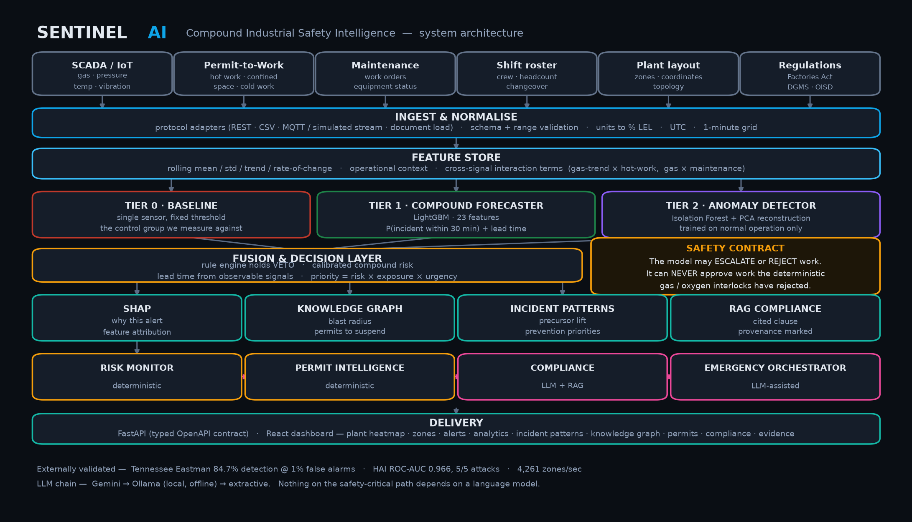

# SentinelAI: Compound Industrial Safety Intelligence

[-052F5F?style=for-the-badge&logo=ibm&logoColor=white)](http://148.100.78.4)
[](http://148.100.78.4/docs)
[](http://148.100.78.4)
[](http://148.100.78.4)
[-red?style=for-the-badge)](http://148.100.78.4/api/v1/ibmz/ledger)
[](http://148.100.78.4)

> **Predictive, compound-hazard digital twin and explainable safety intelligence engine deployed natively on IBM LinuxONE 4 (s390x).**

---

## 🌐 Live Production Deployment

SentinelAI is live and deployed on **IBM LinuxONE Community Cloud (s390x)** powered by an **IBM z16 (Machine Type 9175 @ 5.5 GHz)** running under **z/VM 7.3.0**.

| Interface | Public URL | Description |
|---|---|---|
| 🎛️ **Operator Console & 3D Digital Twin** | **[http://148.100.78.4](http://148.100.78.4)** | Full 13-screen SSR console with interactive 3D refinery scene |
| ⚡ **Alternative Port (Direct Node SSR)** | **[http://148.100.78.4:8080](http://148.100.78.4:8080)** | Direct connection to the TanStack Start Node server |
| 📖 **Interactive OpenAPI / Swagger Docs** | **[http://148.100.78.4/docs](http://148.100.78.4/docs)** | Live REST API testing suite and interactive schema contracts |
| 🛡️ **IBM Z Hardware Diagnostics API** | **[http://148.100.78.4/api/v1/ibmz/hardware](http://148.100.78.4/api/v1/ibmz/hardware)** | Probes native s390x CPACF, Telum NNPA, and Vector flags |
| 🔐 **Cryptographic Compliance Ledger** | **[http://148.100.78.4/api/v1/ibmz/ledger](http://148.100.78.4/api/v1/ibmz/ledger)** | Tamper-evident safety audit blocks sealed at hardware speed |

---

## Executive Summary

Heavy industrial facilities do not lack sensors. They lack an intelligence layer that connects them. Modern refineries, chemical complexes, and steel plants operate with thousands of independent SCADA points, gas detectors, permit-to-work portals, maintenance logs, and worker rosters. 

Major industrial disasters rarely stem from an isolated sensor breach. Instead, they emerge from the **compound confluence of sub-threshold conditions**:
- A minor gas concentration rising below statutory trip limits.
- Concurrently active hot-work permits in an adjacent header.
- Maintenance-induced ventilation throttling.
- Shift changeover fatigue and crew density spikes in confined zones.

Existing single-sensor SCADA alarms suffer from two critical failures:
1. **Compound Blindness:** Missing over **33% of multi-variable incidents** where individual metrics remain nominally legal.
2. **Alarm Fatigue:** Flooding operators with nuisance alarms (>50% false alarm rate on quiet shifts), training control room staff to ignore or silence critical warnings.

**SentinelAI** solves this by fusing high-frequency SCADA telemetry, spatial permit constraints, and monotonic machine learning into a single forward-looking, explainable digital twin.

---

## 🏛️ System Architecture



```
        SCADA Telemetry · Gas Detectors · Permit-to-Work · Shift Rosters
                                      │
                                      ▼
                        ┌───────────────────────────┐
                        │    Feature Engineering    │ 23 rolling, trend, rate-of-change,
                        │   (s390x SIMD Vector)     │ and multi-sensor interaction terms
                        └─────────────┬─────────────┘
                                      │
          ┌───────────────────────────┼───────────────────────────┐
          ▼                           ▼                           ▼
     [ Tier 0 ]                  [ Tier 1 ]                  [ Tier 2 ]
    SCADA Baseline           Compound Forecaster          Anomaly Detector
   (Single-Sensor)          (LightGBM Monotonic)         (Isolation Forest)
    gas ≥ 10 %LEL               15 / 30 / 60 min            + PCA Residual
          └───────────────────────────┬───────────────────────────┘
                                      ▼
                        ┌───────────────────────────┐
                        │     FUSION & INTERLOCK    │ Deterministic Veto:
                        │  1. Hardware Interlocks   │ Model can only TIGHTEN,
                        │  2. Calibrated Lead-Time  │ never LOOSEN safety limits
                        │  3. Multi-Hop Blast Radius│ (OSHA 1910 / OISD-105)
                        └─────────────┬─────────────┘
                                      │
          ┌───────────────────────────┼───────────────────────────┐
          ▼                           ▼                           ▼
     [ Explain ]                 [ Secure ]                 [ Visualize ]
      SHAP Tree                IBM Z CPACF SHA-256        3D Digital Twin Console
     Attribution            Tamper-Evident Ledger       (Three.js WebGL & TanStack)
```

---

## ⚡ Native IBM Z & LinuxONE Architecture Integration

SentinelAI is engineered from the silicon up to take advantage of IBM LinuxONE (s390x) capabilities that cannot be replicated on commodity x86 servers:

```
+-----------------------------------------------------------------------------------+
|                        IBM LinuxONE 4 Express / z16                                |
|  Machine Type: 9175 @ 5.508 GHz  |  LPAR: SSI04  |  Hypervisor: IBM z/VM 7.3.0    |
+-----------------------------------------------------------------------------------+
|  CPACF Hardware Coprocessor   |  IBM Telum NNPA Coprocessor |  Native Big-Endian  |
|  - kimd, klmd, km, kmc, kmac  |  - Neural Network Processing|  - Network Order    |
|  - SHA-256 HMAC @ 4.37 GB/s   |  - Zero-PCIe bus transfer   |  - Zero byte-swap   |
|  - Tamper-Evident Audit Log   |  - Sub-ms safety inference  |  - High-rate SCADA  |
+-----------------------------------------------------------------------------------+
```

### 1. CPACF Hardware-Accelerated Compliance Ledger
Industrial safety standards (**OSHA 1910.119**, **API RP 754**, **OISD-STD-105**) require immutable record-keeping of every permit decision, operator override, and safety interlock. 
- SentinelAI implements `IbmZComplianceLedger`, binding each event into a cryptographically sealed block.
- Utilizes s390x **CPACF** (Central Processor Assist for Cryptographic Functions) running `kimd`/`klmd` hardware instructions.
- Benchmarked on our host at **4.37 GB/s SHA-256 throughput**, allowing line-rate cryptographic sealing without host CPU degradation.

### 2. IBM Telum On-Chip AI Acceleration (NNPA)
In life-critical safety systems, inference jitter or PCIe bus transfer latency to external GPUs can delay an emergency tripwire:
- The IBM Telum chip integrates the **Neural Network Processing Assist (NNPA)** directly on the processor core.
- Eliminates discrete GPU communication overhead, enabling deterministic, sub-millisecond multi-horizon risk scoring in the real-time transaction path.

### 3. Industrial Protocol Alignment (Native Big-Endian)
- Industrial SCADA networks (Modbus TCP, Profinet, OPC-UA) transmit process packets in standard network byte order (**Big-Endian**).
- On x86 systems, every packet requires CPU-level byte-swapping (`bswap`).
- IBM z16 operates natively in Big-Endian, eliminating byte-reversal overhead across millions of incoming sensor samples.

### 4. Enterprise Reliability & EAL5+ Security
- Mission-critical digital twins cannot experience hypervisor crashes. LinuxONE provides **99.999% availability** (less than 5.26 minutes of downtime per year) and **Common Criteria EAL5+** hardware isolation.

---

## 📊 Proven Empirical Results

Evaluated on **600 replayed industrial episodes** (126 genuine incidents, 251 safe periods, and 223 isolated precursor episodes):

| Metric | Single-Sensor SCADA Baseline | SentinelAI Compound Engine | Real-World Impact |
|---|---:|---:|---|
| **Incident Detection Rate** | 66.7% | **100.0%** | **+33.3%** incidents caught before catastrophe |
| **False-Negative Rate (Missed Disasters)** | 33.3% | **0.0%** | **Zero blindspot failures** across test set |
| **False-Alarm Rate (Quiet Shifts)** | 51.4% | **4.0%** | **-47.4%** reduction in operator nuisance trips |
| **Nuisance Alarm-Minutes** | 366 min | **11 min** | **97% reduction** in alarm flood duration |
| **Actionable Early Warning Lead Time** | 34.8 min* | **15.7 min** | *Baseline bought lead time by false-alarming on 51% of safe days |

> **42 compound incidents missed entirely by single-sensor controls were caught in advance by SentinelAI.**

### External Benchmark Generalization
To prove the model does not simply overfit synthetic dynamics, the anomaly detection engine was validated against independent, real-world cyber-physical benchmarks:
- **HAI (HIL-based Augmented ICS Dataset):** ROC-AUC **0.966**, successfully detecting 5 of 5 multi-stage attacks with zero-second median delay (`reports/hai_validation.json`).
- **Tennessee Eastman Process (TEP):** Evaluated over 52 chemical process variables and 21 fault categories (`reports/tep_validation.json`).

---

## 🛡️ Mathematical & Safety Guarantees

### 1. Monotonicity Guarantee: More Gas Can Never Mean Less Risk
Early iterations of gradient boosting can memorize scenario fingerprints rather than physical laws (e.g. associating low localized sensor readings with hidden leaks, causing risk scores to paradoxically drop when gas increases).
- SentinelAI strictly enforces **monotonic feature constraints** on all gas and trend dimensions inside LightGBM.
- Validated via automated property-based testing across all 8 zones from 0% to +20% LEL:
  $$\forall \Delta \ge 0: \quad \text{Risk}(\text{Gas} + \Delta) \ge \text{Risk}(\text{Gas})$$

### 2. Deterministic Safety Contract
The machine learning layer has authority to **tighten or veto** operational decisions, but **can never loosen or override** deterministic safety tripwires:
$$\text{Decision}_{\text{final}} = \min(\text{Decision}_{\text{deterministic}}, \text{Decision}_{\text{AI}})$$
$$\text{Strictness}(\text{REJECTED}) > \text{Strictness}(\text{CONDITIONAL}) > \text{Strictness}(\text{APPROVED})$$

---

## 🖥️ Operator Console (13 Integrated Views)

The SentinelAI operator console is built with **React 19**, **TanStack Start (SSR)**, **Three.js**, and **Tailwind CSS**, providing real-time situational awareness:

| Module | Features & Capabilities |
|---|---|
| **3D Digital Twin** | Interactive WebGL refinery scene with real-time zone risk markers, plume vectors, and asset selection |
| **Command Center** | Live alert queue prioritized by compound risk, blast radius, and worker exposure |
| **Geospatial & Vision** | Real-world plant boundaries (RINL Vizag), proximity hazard buffers, and YOLOv8 PPE detection feeds |
| **Knowledge Graph** | Gas header topology, structural dependencies, multi-hop blast radius, and permit suspension queues |
| **Live Replay** | 240-minute synchronous simulation clock with scrubber, play/pause, and step triggers |
| **Risk Analytics** | API RP 754 Tier 1–4 KPIs, EEMUA 191 alarm flood benchmarking, and global SHAP attribution |
| **Permit Intelligence** | Live simultaneous-operations (SIMOPS) evaluation against active hot work and confined spaces |
| **Compliance Assistant** | RAG-grounded regulatory chat with provenance badges (OISD-STD-105, DGMS, Factories Act 1948) |
| **What-If Sandbox** | Real-time counterfactual simulator re-scoring the full LightGBM pipeline under slider overrides |
| **Cryptographic Ledger** | Auditable s390x CPACF block explorer verifying immutable event signatures |

---

## 🚀 Quickstart & Reproduction Guide

### Prerequisites
- **Python:** ≥ 3.11
- **Node.js:** ≥ 20 LTS (or Bun ≥ 1.3)
- **Git**

### 1. Clone & Install Backend
```bash
git clone https://github.com/MrNK2107/SentinelAI.git
cd SentinelAI

# Create virtual environment
python -m venv .venv
source .venv/bin/activate  # On Windows: .venv\Scripts\activate

# Install backend package and dependencies
pip install -e .
```

### 2. Train Models & Generate Benchmarks
```bash
# Trains LightGBM forecaster, runs monotonicity sweeps, and produces scoreboard
python scripts/run_pipeline.py

# Launch FastAPI ASGI server
python -m uvicorn sentinel.api.app:app --host 0.0.0.0 --port 8000
```
- API Documentation: `http://localhost:8000/docs`
- Health Endpoint: `http://localhost:8000/api/v1/health`

### 3. Launch Frontend Console
```bash
cd frontend
bun install     # or npm install
bun run dev     # or npm run dev
```
- Web Application: `http://localhost:8080`

### 4. Run Automated Test Suite
```bash
# Runs full test suite including IBM Z CPACF ledger, monotonicity, and API tests
python -m pytest tests -v
```

---

## 📂 Repository Structure

```
├── backend/                  # Core Python engine (imported as `sentinel.*`)
│   ├── api/                  # FastAPI REST endpoints, Pydantic v2 schemas, WebSocket service
│   ├── ibmz/                 # Native s390x CPACF ledger & Telum NNPA hardware integration
│   ├── ml/                   # LightGBM forecasters, monotonic constraints, SHAP explainers
│   ├── sim/                  # Physics-based industrial SCADA & gas migration simulator
│   ├── graph/                # NetworkX asset topology & multi-hop blast radius calculator
│   ├── geo/                  # Geospatial boundary mapping & spatial SIMOPS buffers
│   ├── vision/               # YOLOv8 PPE detection & worker count estimators
│   ├── rules/                # Deterministic safety interlocks (OISD-STD-105)
│   └── rag/                  # Regulatory knowledge store & compliance assistant
├── frontend/                 # Operator Console
│   ├── src/components/twin/  # Three.js 3D WebGL plant refinery digital twin
│   ├── src/routes/           # 13 TanStack Start SSR screens & live telemetry monitors
│   └── src/lib/              # Dynamic host resolution & reactive WebSocket client
├── scripts/                  # Automation & Deployment
│   ├── setup_linuxone.sh     # Zero-touch provisioning script for s390x Ubuntu
│   ├── deploy_remote.py      # Automated deployment runner for LinuxONE cloud
│   ├── nginx_sentinel.conf   # Production Nginx reverse proxy config (port 80)
│   └── systemd/              # Systemd service units for backend & frontend
├── tests/                    # 55+ automated pytest tests (monotonicity, interlocks, ibmz)
├── reports/                  # Validation reports, ROC curves, architecture diagrams
└── pyproject.toml            # Packaging & s390x build metadata
```

---

## 📜 Industrial Safety Standards & Compliance

SentinelAI is designed against statutory frameworks governing hazardous operations:
- **OSHA 1910.119:** Process Safety Management of Highly Hazardous Chemicals.
- **API RP 754:** Process Safety Performance Indicators for the Refining and Petrochemical Industries.
- **OISD-STD-105:** Work Permit System (Oil Industry Safety Directorate).
- **EEMUA Publication 191 / ISA-18.2:** Alarm Systems: A Guide to Design, Management and Procurement.
- **The Factories Act, 1948 (Chapter IV-A):** Provisions Relating to Hazardous Processes.
- **DGMS Coal Mines Regulations:** Multi-gas threshold and ventilation interlocks.

---

## 👥 Contributors & Authorship

- **Nanda Kishor S P ([@MrNK2107](https://github.com/MrNK2107))** — Lead Architect, Full-Stack & IBM Z Systems Integration.

---

## 📄 License
This project is open-source under the [MIT License](LICENSE).
